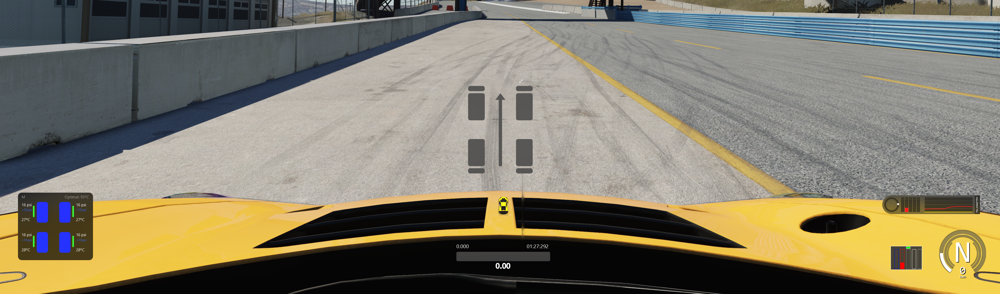
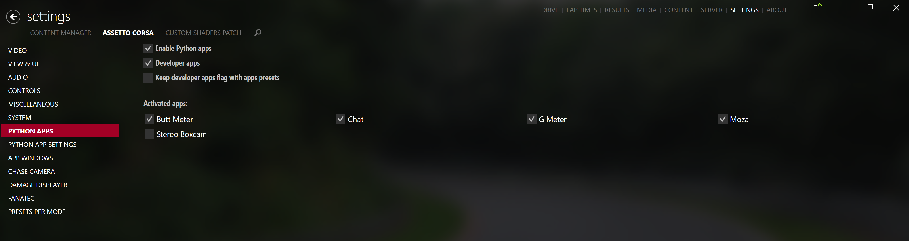

# py-assettocorsa-buttmeter

A widget for Assetto Corsa that help you understand what happens with your tires. Uses Tire speed, Tire slip and Body slip to give a visual indication when you are on the edge.

## Install

1. Download `ButtMeter.zip` from GitHub release.
1. Drag `ButtMeter.zip` into Content Manager.
1. Go to `Settings > Assetto Corsa > Python Apps`.
1. Tick the `Butt Meter` checkbox.

